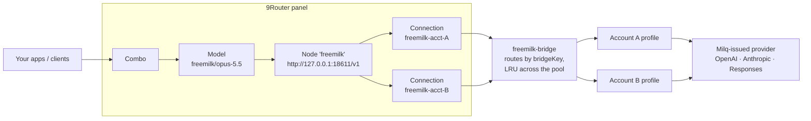

<p align="center">
  
</p>

<h1 align="center">freemilk-bridge</h1>

<p align="center">
  <strong>Turn FreeMilk (Milq AI) accounts into a pooled, OpenAI-compatible upstream for 9Router.</strong><br>
  One bridge, many accounts — each account becomes its own 9Router connection.
</p>

<p align="center">
  
  
  
  
  
  
</p>

---

FreeMilk's app receives a **provider profile** (`baseURL`, `apiKey`, …) from
`api.milq.ai` after sign-in and talks directly to that provider.
freemilk-bridge holds those profiles for **one or many accounts** and
re-exposes them on localhost as a plain OpenAI-compatible endpoint — so a
router such as **9Router** can consume FreeMilk's hosted models (including
the "Thirsty Model" **Opus 5.5**) like any other provider, with the
router's native connection rotation spreading load across your accounts.

## 🚀 Quickstart — 3 steps

```bash
# 1. Install (renders + enables the systemd service; ./run.sh works too)
bash install.sh

# 2. Log in once per account — browser sign-in, paste the token JSON once
python3 login_fetch.py login
#    …or many accounts at once:
python3 login_fetch.py bulk-add accounts.json

# 3. Auto-register in 9Router (asks for the console password once)
python3 login_fetch.py sync-9router
```

That's the whole flow. Step 3 detects your local 9Router, creates the
`freemilk` node, registers **one connection per account**, and adds the
`freemilk/opus-5.5` model. Add the model to any combo in the panel and
you're serving. Re-running step 3 after adding accounts only adds the
new connections.

<details>
<summary>Sample session</summary>

```console
$ bash install.sh
install: freemilk-bridge service enabled + started (port 18611)
install: bridge healthy at http://127.0.0.1:18611/health

$ python3 login_fetch.py login
Step 1: open http://127.0.0.1:18620/auth.html in a browser on this
machine (or tunnel port 18620) and sign in with Google…
Step 2: paste that JSON here, then press Ctrl-D:
tokens stored: firebaseIdToken, firebaseRefreshToken
Step 3: fetching the provider profile from FreeMilk...
LOGIN OK — provider profile fetched; the bridge is configured.

$ python3 login_fetch.py sync-9router
9Router console password: ********
sync: created node FreeMilk (prefix freemilk -> http://127.0.0.1:18611/v1)
sync: created connection freemilk-acct-1a2b3c4d
sync: registered custom model freemilk/opus-5.5
sync-9router: OK — node 'freemilk', 1 account connection(s), model freemilk/opus-5.5
```

</details>

> 🤖 **Letting an AI agent drive?** Point it at [AGENTS.md](AGENTS.md) —
> a complete unattended runbook (install → login → sync → verify →
> troubleshoot) with the safety rules baked in.

## ✨ Features

| | Feature | What it does |
|---|---|---|
|  | **Multi-account pool** | Serve from many FreeMilk accounts at once; requests spread least-recently-used across healthy accounts. A single account is just a pool of 1. |
|  | **Per-account bridge keys** | Every account gets its own key (`fmb_<accountId>_…`). Presenting it pins the request to that account — this is what makes router-side rotation work. |
|  | **9Router auto-registration** | `sync-9router` detects the local panel and idempotently creates the node, one connection per account, and the custom model. Re-runs add new accounts and disable stale connections. |
|  | **Self-healing credentials** | On an upstream 401 the bridge runs the profile's refresh hook once, persists the rotated credential (0600), and retries. |
|  | **Dead-account isolation** | An account that fails auth even after refresh is marked dead and skipped; the rest of the pool keeps serving. |
|  | **Streaming, three wire formats** | OpenAI passthrough (SSE byte-for-byte), Anthropic Messages translation, and OpenAI Responses translation — buffered and streamed. |
|  | **Pure web login** | No iPhone, no app, no emulator: a standard Firebase web sign-in plus a one-time token paste. Bulk-add whole batches of accounts from one file. |
|  | **Localhost-only, secret-safe** | Binds 127.0.0.1, credentials file is 0600, and logs/outputs never contain keys or tokens. Zero dependencies — Python 3 standard library only. |

## 🏗️ Architecture



### How accounts show up in 9Router

| FreeMilk account | In `credentials.json` | 9Router connection | Key the router sends |
|---|---|---|---|
| Account A | `accounts[0]`, id `acct-1a2b3c4d` | `freemilk-acct-1a2b3c4d` | `fmb_acct-1a2b3c4d_…` |
| Account B | `accounts[1]`, id `acct-5e6f7a8b` | `freemilk-acct-5e6f7a8b` | `fmb_acct-5e6f7a8b_…` |
| Legacy single account | top-level profile | `freemilk-default` | `fmb_default_…` |

The router rotates across its connections; each connection's key pins
the request to one account in the bridge. A connection used *without* a
per-account key (or with the optional master `BRIDGE_API_KEY`) falls
back to pool selection.

## 🔧 Configuration

Environment variables (bridge): `FREEMILK_BRIDGE_HOST` (default
`127.0.0.1` — keep it localhost-only), `FREEMILK_BRIDGE_PORT` (`18611`),
`FREEMILK_BRIDGE_CREDENTIALS`, `BRIDGE_API_KEY` (optional master key),
`FREEMILK_BRIDGE_CONCURRENCY` (`8`), `FREEMILK_BRIDGE_ACCOUNT_CONCURRENCY`
(`1` per account). For `sync-9router`: `PANEL_BASE_URL` (default
`http://127.0.0.1:2013`), `PANEL_PASSWORD`, `FREEMILK_BRIDGE_BASE_URL`
(default `http://127.0.0.1:18611/v1`).

## 🔒 Security notes

- The bridge is a **localhost service**. Do not bind it to a public
  interface; your router reaches it on the same box.
- `credentials.json` holds live provider credentials and Firebase
  refresh tokens — it is written **0600**, is gitignored, and no tool
  here prints its values (`status` shows field names and states only).
- Token JSONs and the panel password are accepted **via stdin / prompt
  / env only** — never via argv — and are never logged.
- `sync-9router` touches **only** the `freemilk` node, that node's
  connections, and the `freemilk/opus-5.5` custom model.

<details>
<summary><strong>Manual 9Router wiring</strong> (fallback — sync-9router does exactly this)</summary>

1. **Provider Nodes → Add node**
   - Type: *OpenAI Compatible*, Name: `FreeMilk`, Prefix: `freemilk`
   - API type: *Chat*, Base URL: `http://127.0.0.1:18611/v1`
2. **Connections → Add** on that node, once per account:
   - Name: `freemilk-<accountId>` (e.g. `freemilk-acct-1a2b3c4d`)
   - API key: the account's `bridgeKey` from `credentials.json`
     (run `sync-9router` once to have keys issued, or set a master
     `BRIDGE_API_KEY` on the bridge and use that value)
3. **Models → Custom models → Add**: provider alias `freemilk`,
   model id `opus-5.5`.
4. **Combos**: add `freemilk/opus-5.5` to any combo.

> Note: the console's *validate* button fetches `{baseUrl}/models`
> from your browser session and may refuse localhost URLs when the
> console itself is opened through a tunnel (SSRF guard). Node
> creation and chat execution happen server-side and work regardless —
> verify with a real chat through the panel instead.

</details>

<details>
<summary><strong>How the login works</strong> (and the App Check caveat)</summary>

FreeMilk sign-in is Firebase Authentication on project `milq-mobile`.
After sign-in, the app fetches a *hosted model catalog* from
`api.milq.ai`; entries carry the provider profile the bridge replays.
The exact issuance path is assembled dynamically in the app, so
`login_fetch.py` tries an ordered candidate list with the available
auth variants (portal session cookie, Firebase Bearer, both, Milq
Bearer) and keeps the first response containing a profile. The winning
endpoint is remembered in the credentials file.

No Apple device is needed: `auth.html` (served by
`login_fetch.py login`, or standalone via `serve-auth`) performs a
standard Firebase **web** sign-in — `localhost` is an authorised
Firebase origin by default — and shows the ID token + refresh token
JSON to paste back once. Alternatively, sign in at
https://account.milq.ai and hand over the session cookie.

**⚠️ App Check risk.** The app ships Firebase App Check with App
Attest. Whether the profile-issuance endpoint *enforces* it is
unknowable until the first live login: the account portal surface
(`/account/api/*`) is cookie-authenticated and cannot be
App-Check-gated (browsers can't produce App Attest assertions), but an
app-only issuance path could be. A captured `appCheckToken` can be
stored and will be attached — but if issuance turns out to be fully
attestation-gated, a pure server-side bridge is impossible and the
first `fetch` will show it (every candidate 401/403).

**Economics & ToS.** Opus 5.5 draws from a small per-account daily
allowance ("Sips"), and FreeMilk's terms prohibit extracting provider
information / misusing the service. A bridge yields each account's
daily ration and carries account-termination risk; treat traffic
through it as non-private. Pooling accounts multiplies the ration —
and the risk. You are responsible for your own accounts.

</details>

<details>
<summary><strong>Credentials format</strong></summary>

See `credentials.example.json`. Two shapes, freely combinable — the
bridge serves every profile it finds:

- **Legacy single account:** provider profile fields at top level
  (`baseURL`, `apiKey` required; `protocol`, `model`, `models`,
  `sessionId`, `extraHeaders`, `maxApiTokens`, `refreshCredentials`
  optional), login material under a top-level `milq` object.
- **Pool:** an `accounts` array; each entry carries the same profile
  fields plus `id`, its own `bridgeKey`, and its own `milq` object.
  An entry may also carry `dead: true` (set automatically when the
  account's credential dies).

The file hot-reloads whenever it changes; the bridge starts cleanly
unconfigured (`503 {"error": "freemilk-bridge not configured"}`) when
no profile exists yet.

</details>

<details>
<summary><strong>Troubleshooting</strong></summary>

| Symptom | Likely cause | Fix |
|---|---|---|
| `sync-9router` exits 2, "panel login failed" | Wrong console password, or no 9Router at `PANEL_BASE_URL` | Re-check password; verify the panel URL (default `http://127.0.0.1:2013`) |
| Chat → 503 "not configured" | No account has a profile yet | Complete the login step; `login_fetch.py fetch` retries issuance |
| Chat → 401 from the bridge | Presented key matches neither master key nor any `bridgeKey` | Use the connection's bridgeKey, or set `BRIDGE_API_KEY` |
| `accountsHealthy` dropped, an account shows `dead` in `status` | That account's credential died (refresh failed too) | Re-login that account (`login` / `bulk-add`), then re-run `sync-9router` |
| Every fetch candidate 401/403 mentioning App Check | Issuance is attestation-gated | See the App Check caveat above — a captured `appCheckToken` is the only path |
| Console *validate* fails but chats work | SSRF guard on localhost base URLs via tunneled console | Ignore validate; verify with a panel chat |

</details>

## 🧪 Tests

All offline — mock upstreams, a fake Firebase/Milq backend, and a mock
9Router panel implementing the real console contract:

```bash
python3 tests/selftest.py        # bridge: protocols, refresh, 9Router shapes, pool (37 checks)
python3 tests/login_selftest.py  # set-tokens / fetch / login / bulk-add (20 checks)
python3 tests/sync_selftest.py   # sync-9router idempotency + lifecycle (11 checks)
```

## 📁 Files

| File | Purpose |
|---|---|
| `bridge.py` | the bridge server (stdlib only) |
| `login_fetch.py` | login, bulk-add, profile fetch, `sync-9router` |
| `auth.html` | one-time Google sign-in page (shows ID + refresh token) |
| `install.sh` / `run.sh` | one-command install (systemd) / no-systemd runner |
| `freemilk-bridge.service` | systemd unit template (rendered by `install.sh`) |
| `credentials.example.json` | credentials contract example (no real values) |
| `AGENTS.md` | unattended operator runbook for AI agents |
| `tests/` | mock upstream, fake Milq, mock panel + self-tests |
| `docs/assets/` | logo + feature icons (self-contained SVGs) |

## License

MIT — see `LICENSE`.
